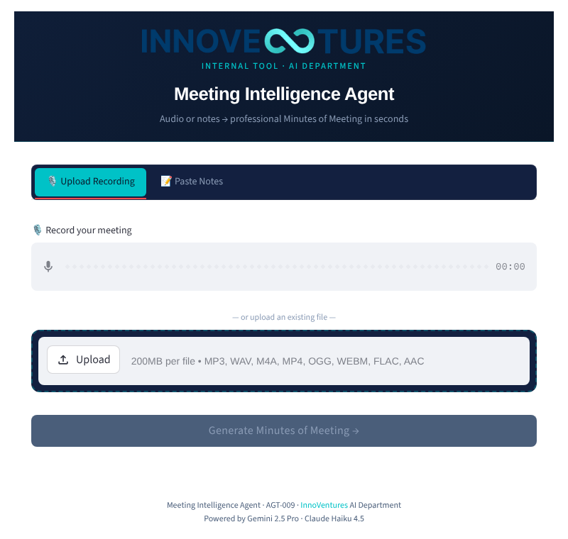
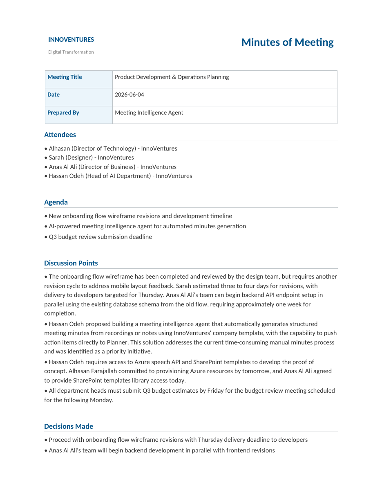
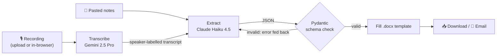

# Meeting Intelligence Agent (AGT-009)

Turns a meeting recording or pasted notes into a finished **Minutes of Meeting (MoM)** Word document — attendees, agenda, thematic discussion points, decisions, assigned action items with due dates, and follow-ups — in the company's branded template, ready to download or email.

Built solo during my AI Consultant internship at **InnoVentures** (Abu Dhabi, May–June 2026) as an in-house tool for the AI Department, replacing manual note-taking after internal and client meetings, including in-person meetings that meeting-platform tools don't cover.

<p align="center">
  
  &nbsp;
  
</p>

## How it works



1. **Transcribe** (`pipeline/transcribe.py`) — Gemini 2.5 Pro via OpenRouter, prompted with known team names so Arabic names are spelled correctly and speakers are labelled.
2. **Extract** (`pipeline/extract.py`) — Claude Haiku 4.5 turns the transcript into structured JSON. The prompt groups discussion **by topic, not by speaker turn**, prevents over-splitting action items, resolves relative dates ("by Thursday"), and translates Arabic content to English.
3. **Validate & self-correct** — output is validated against a Pydantic schema (`models/meeting.py`). If the JSON is malformed or a field is invalid, the validation error is sent back to the model to fix (up to 3 attempts) instead of crashing the run.
4. **Render** (`pipeline/template.py`) — fills the branded `.docx` template, rebuilds the action-item table, and fixes pagination.
5. **Deliver** (`app.py`, `utils/email_sender.py`) — Streamlit UI with preview, download, and email via Resend.

All model calls go through **OpenRouter**, so any stage can be switched to another provider by changing one model string.

## Model selection: benchmarks

Models were chosen by benchmark rather than by default. Both studies used a scripted 4-person meeting with a known ground truth. Full write-ups are in [`reports/`](reports/); raw outputs are in [`tests/`](tests/).

**Transcription — 8 models** ([report](reports/Transcription_Benchmark_Report.docx), [script](tests/test_transcrption_benchmark.py))

| Model | Got "Omar" right? | Speaker labels | Time |
|---|---|---|---|
| **Gemini 2.5 Pro** ✅ chosen | ✓ | ✓ | 27.4s |
| Gemini 2.5 Flash | ✓ | ✗ | 18.9s |
| GPT-4o Transcribe | ✗ ("Amr") | ✗ | 6.5s |
| Whisper v3 Turbo | ✗ ("Amar"/"Amr") | ✗ | 2.2s |
| Google Chirp 3 | failed (empty) | — | 13.1s |

Gemini 2.5 Pro was the only model that both spelled every Arabic name correctly and produced speaker-labelled dialogue, which the extraction step depends on. Speed was traded for accuracy because the target was "minutes in under 10 minutes," not real time.

**Extraction — 6 models, 2 prompt versions** ([report](reports/Extraction_Benchmark_V2_Report_1.docx), [script](tests/test_extraction_benchmark_v2.py))

| Model | Time | Decisions | Follow-ups | Resolved "Speaker 1" | Cost ($/M in/out) |
|---|---|---|---|---|---|
| Claude Sonnet 4.6 | 18.2s | 7 | 5 | ✓ | 3.00 / 15.00 |
| **Claude Haiku 4.5** ✅ chosen | 7.7s | 5 | 5 | ✓ | 0.80 / 4.00 |
| Gemini 2.5 Flash | 5.0s | 5 | 4 | ✓ | 0.15 / 0.60 |
| GPT-4o | 4.7s | 4 | 4 | ✗ | 2.50 / 10.00 |
| DeepSeek Chat | 60.2s | 6 | 4 | ✗ | 0.14 / 0.28 |

Key findings:
- **Prompt changes mattered as much as model choice.** The V2 prompt took Gemini Flash from 0 to 4 follow-ups and removed "Speaker 1/2/3" from attendee lists across models.
- Only the Claude models inferred who was leading the meeting from context.
- Haiku over-split action items in V2 (9 vs. 6 expected); the final prompt adds explicit rules against splitting tasks.
- Haiku gave near-Sonnet follow-up quality at about a quarter of the cost.

## Sample output

- [`tests/sample_transcript.txt`](tests/sample_transcript.txt) — the scripted benchmark meeting.
- [`output/`](output/) — MoMs generated during development, from both scripted test meetings and real InnoVentures meetings, shared with the AI Department's approval.

## Running it

```bash
pip install -r requirements.txt
cp .env.example .env              # then add your OPENROUTER_API_KEY (and RESEND_API_KEY for email)

streamlit run app.py              # web app
python demo.py tests/sample_transcript.txt   # CLI, text input (no audio cost)
python demo.py tests/sample_audio.m4a        # CLI, full audio pipeline
```

Tests run offline with the LLM stubbed, so no API key is needed:

```bash
pip install -r requirements-dev.txt
pytest
```

They cover the self-correction loop (fenced JSON, invalid fields, non-JSON replies, giving up after 3 attempts), call-time dates, and document rendering. The benchmark scripts in `tests/` call real models and are run separately.

## Scope and design decisions

This was built as an **in-house tool for a single company**, and several choices follow from that:

- **Company context is hard-coded.** Team names and roles sit in the prompts because that's what fixed name accuracy. A multi-tenant version would load a per-organisation glossary instead.
- **Trusted users only.** No authentication, rate limiting or input sanitisation beyond basic HTML escaping in the UI; it was meant for an internal network. Exposed publicly, it would need auth and stronger prompt-injection handling, since meeting audio flows straight into the LLM.
- **Cloud models via OpenRouter.** One API covers every provider, which made it cheap to benchmark many models and swap the winner in. It's also a low-cost alternative to commercial meeting-minutes tools.
- **Synchronous calls.** Processing one meeting at a time was the use case, so there's no queueing.

## Known limitations and next steps

- **The benchmarks are small** — one ~2-minute recording, one speaker reading all four parts, scored manually. A proper evaluation would use several real recordings, word error rate against reference transcripts, and gold-standard minutes scored automatically.
- **Per-model transcripts were overwritten** by a later re-run; only Gemini 2.5 Pro's output survived. The summary figures in `benchmark_results.json` and the report are from the original run.
- **No feedback loop yet.** The natural next step is letting users correct the generated minutes and feeding those corrections back as few-shot examples, so the agent improves with use.
- **Planned integrations** that weren't built: pushing action items to Microsoft Planner and reading speaker names from Teams metadata.

## Project structure

```
app.py                 Streamlit web app
demo.py                CLI demo with cost estimate
config.py              Secrets: Streamlit secrets → .env fallback
pipeline/              transcribe → extract → template
models/meeting.py      Pydantic schema for the MoM
utils/email_sender.py  Resend email delivery
templates/             Branded .docx templates
tests/unit/            Offline pytest suite
tests/                 Benchmark scripts, sample inputs and raw results
reports/               Benchmark write-ups
scripts/list_models.py List models available on OpenRouter
```
